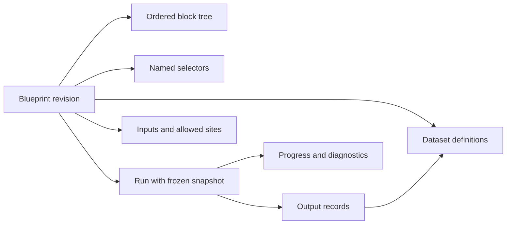
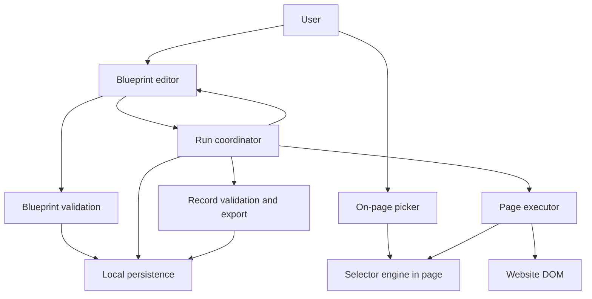
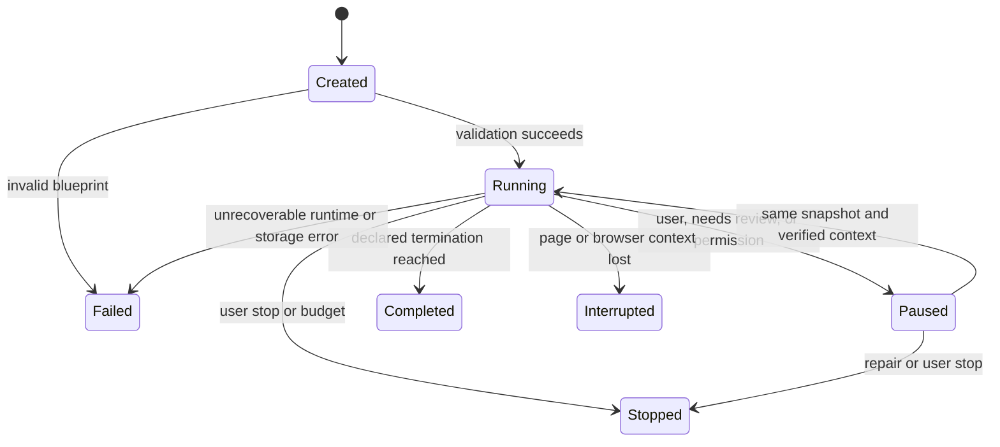

# OctoGrab — system design draft

Date: 11 October 2026  
Status: design proposal with an initial WXT sidebar authoring shell implemented. The selector picker and execution runtime remain planned.

## 1. Product intent and decision status

OctoGrab is a browser extension that helps nontechnical users create reusable blueprints for extracting data from public websites they are authorized to scrape. Users configure blocks, arrange their order and children, select targets on the live website, preview the output, and run the blueprint locally.

The product should remain general. Product catalogs, directories, articles, and search results are examples used to test the design, rather than categories built into the runtime. The available block behaviors define the workflows users can express. Adding a new behavior should extend that vocabulary without changing existing blueprints.

### Confirmed by the user

- A blueprint consists of configurable blocks with parent–child relationships.
- Users should be able to compose different use cases from those blocks.
- The selector engine is a central part of the system.
- When a website layout breaks a blueprint, the user reselects elements or edits the blueprint.
- The first version creates and executes blueprints in the user's browser.
- We design the system before implementing it.

### Proposed in this draft

- A structured block tree with ordered children and named child slots.
- Explicit page scope, item scope, captured values, and record emission.
- A side panel editor, an element picker on the page, and a data preview.
- A sequential runtime with saved progress and immutable blueprint snapshots for runs.
- Local persistence, CSV and JSON export, and site access requested when needed.
- General blocks for interaction, data, iteration, conditions, and page contexts.

These proposals are starting points for discussion. The browser constraints cited below are documented platform behavior; the architecture built around them is our design judgment.

### Product promise

“Build a reusable extraction workflow by arranging steps and selecting what you want on the website.”

The promise is composability across supported websites. Expressive blocks cannot guarantee access to every website, reproduce every human interaction, or detect every incorrect extraction.

## 2. The user's mental model

A blueprint answers five questions:

1. Where do we start?
2. What actions do we take?
3. What repeats or depends on a condition?
4. Which values do we read, and which belong in the same output record?
5. When do we stop?

Users should see ordinary language such as “Click this button,” “For each item,” “Read these fields,” and “Save this row.” Internally, the output action is named `emitRecord`; its user-facing label can be “Save row.”

Selecting a field is a guided interaction: click an example, name the field, inspect highlighted matches, and confirm the preview. CSS and technical scope identifiers belong in an advanced editor, rather than being prerequisites for completing a blueprint.

Drag and drop moves blocks, changes their order, and places them into valid child slots. Buttons and keyboard commands must offer the same operations. The editor rejects moves that would make a field reference unavailable or put an item selector outside its corresponding loop.

## 3. The central model

The glossary in [CONTEXT.md](./CONTEXT.md) defines the terms. The relationships are:



A blueprint is saved intent. A run is a particular attempt to execute that intent. A selector is a durable description of a target; a live DOM element is a temporary result of resolving that description.

An item is an element or input value being iterated over. A record is an output row. The distinction prevents an element loop from secretly generating, duplicating, or joining data.

## 4. Block composition and execution semantics

### Use a structured tree first

The blueprint root is an ordered sequence. Children execute in order within the semantics of their parent. Action blocks have no child slots. Container blocks declare their permitted child slots.

| Container | Child slots | Meaning |
| --- | --- | --- |
| Group | `body` | Run these blocks once in order; a group adds no search or value scope. |
| For each | `body` | Run once for each selected item or supplied value, with a fresh iteration context. |
| If | `then`, `else` | Evaluate a condition and execute exactly one branch. |
| Repeat until | `body`, `between` | Execute the body, check the stop condition, then execute `between` before another iteration. |
| With page | `body` | Open a URL in an owned tab, execute the body in that page, then return to the caller's page context. |

This structure supports nested loops, branches, and detail page visits. Arbitrary connections between blocks would also need rules for merging branches, scheduling cycles, and joining values. We can add that only if an actual workflow cannot be expressed clearly with the tree.

### Repeat semantics must be precise

“Repeat until” follows this order:

1. Check the iteration and run budgets.
2. Execute `body`.
3. Evaluate the stop condition on the resulting page and values.
4. If it is true, leave the container.
5. Otherwise execute `between`, verify any required progress, and begin the next iteration.

Checking the stop condition after the body and before advancing is deliberate. For pagination, the last page must be extracted even if it has no Next button. A preview shows the checkpoint between `body` and `between` so users can understand this order.

### Context changes are explicit

The runtime distinguishes the current page, an item scope, and visible captured values. Nesting alone does not change them.

- A Group retains its caller's context.
- A For each over DOM targets introduces an item scope tied to a particular page document.
- A For each over values introduces an item value, rather than a new DOM search root.
- A With page introduces a page context. It can read captured values from its caller, but cannot use a caller's DOM element as a search root in the new page.
- Navigate replaces the current document and invalidates item scopes belonging to the old document. Continuing such a loop requires saved data and a valid recovery strategy; the default response is to pause.

For each and Repeat until create fresh local value scopes for every iteration. With page creates a local value scope for its page visit. Child blocks can read earlier values and values from enclosing scopes. They do not overwrite enclosing values. Local outputs disappear when that scope exits. A Repeat until stop condition and its `between` steps can read values from that iteration's body. Group and the selected If branch use their caller's value scope, but a value produced in only one branch is unavailable after If unless both branches explicitly provide the same declared output. Initially, the editor can require consumers to remain inside the relevant branch instead of implementing output merging.

Read and transform outputs are referenced by stable block ID and output key. Renaming a visible label does not break a reference. Each iteration gets its own instance of those outputs, so a missing value in one item cannot reuse the value from the previous item.

### General block vocabulary

| Block | User configures | Output or effect |
| --- | --- | --- |
| Navigate | URL from an input, literal, or captured value | Changes the current page. |
| Click | Target, expected page effect | Performs one interaction and checks its result. |
| Fill input | Target and value source | Sets a supported input and verifies its resulting value. |
| Choose option | Target and option value or label | Selects a supported native option. |
| Wait | Condition and timeout | Waits for a known page state; a fixed delay is also available. |
| Scroll | Container or page, direction, progress condition | Scrolls and checks whether expected content appeared. |
| Read values | Named mappings from selectors, attributes, or current URL | Captures data for later blocks. |
| Transform value | Input and a supported operation | Produces a new value without changing the source. |
| Emit record | Dataset and field mappings | Validates and saves one complete output record. |
| For each | DOM selection or list of values | Repeats its body with a fresh item context. |
| If | Condition and branches | Chooses which branch runs. |
| Repeat until | Body, stop condition, between steps, iteration limit | Repeats a bounded sequence. |
| With page | URL source and page readiness condition | Executes children on another page while preserving the caller. |
| Group | Label and children | Organizes a sequence. |
| Stop | Stop the current loop or the run, with a reason | Ends execution at a defined checkpoint. |

Supported transforms should start with small, explicit operations such as trimming, replacing literal text, splitting, joining, and resolving a relative URL. Locale-sensitive number/date parsing needs an explicit format and real test cases before support is claimed. User-defined JavaScript is outside the initial design.

Conditions use a finite vocabulary: target exists, target is missing, target is visible, target is enabled, text equals or contains a value, captured value comparison, and list length comparison. Users can combine conditions with AND, OR, and NOT. A configuration object expresses the condition; no configuration string is evaluated as code.

Condition observation distinguishes a legitimate false result from a selector error. For example, zero matches makes an existence check false and a missing check true; a Wait continues until its condition succeeds or times out. Invalid scope, invalid CSS, or unexpected ambiguity remains an error. A consuming Click always requires exactly one valid match even if the selector also permits absence when used as a stop condition.

### One definition per block type

The editor and runner share a built-in block definition: stable type ID, configuration rules, permitted child slots, required scopes and value sources, declared outputs, and execution behavior. Picker, condition, and value-binding controls are reused in the forms.

This is a small built-in registry, not a downloadable plugin framework. Adding a built-in block means adding its definition, configuration form, execution behavior, and one meaningful scenario test. Format changes require migration or a clear unsupported-format error.

## 5. Selector engine

### Responsibility

The selector engine helps the user describe a target, reports what that description matches, and resolves it again during execution. It never silently switches to a different target or edits the blueprint to repair a failed match.

Its small interface is:

- `capture(examples, scope, intent)` returns proposed selector descriptions.
- `preview(selector, scope)` returns match counts, highlights, sample values, and structural warnings.
- `resolve(selector, scope, expectation)` returns matching elements for the current document or a specific diagnostic.

Complex candidate generation and validation stay inside this module. Blocks use the same resolver, so scoping and match validation behave consistently across clicking, waiting, reading, and iteration.

### Saved selection information

| Information | Purpose |
| --- | --- |
| Selector ID and label | Stable references from blocks and a useful name in the editor. |
| Search scope | Current page or a specific enclosing item loop. |
| Locator rule | The approved CSS rule and, where supported, an explicit text filter. |
| Expected matches | Exactly one, zero or one, or a collection with a configured minimum. |
| Structural expectations | Relevant tag, attribute presence, or other approved target properties. |
| Selection evidence | Example values and pages used during preview, with minimal retained data. |

Reading text, `href`, `src`, or another attribute belongs to the read mapping rather than the locator. The same selected link can be used for navigation and URL extraction without duplicating its selector.

Initially, use CSS selection with explicitly scoped relationships. Candidate generation can favor meaningful attributes and short relative paths. A button's label can be a useful constraint; an article's changing headline should not become a literal text constraint for extracting all headlines. A full accessibility-role locator implementation is a separate capability and must not be implied by offering basic attribute and text matching.

The picker should flag generated-looking IDs and classes, long ancestry paths, and positional rules. It may need to use a positional rule on some sites, but it should show that limitation and test it on more than one sample. Warnings describe evidence; they do not claim a calibrated probability of correctness.

### Repeated item inference

The user selects two examples when one example cannot identify the intended repeated wrapper. The picker proposes a common pattern, highlights all matches, and lets the user adjust the wrapper before selecting fields inside it.

Each output field resolves within the same current item. Never collect all titles and all prices globally and pair them by array position. A missing price would shift the association for later records. Existing scraper documentation uses parent element selection to preserve this relationship. [Web Scraper selectors](https://webscraper.io/documentation/selectors)

An item-scoped selector names its enclosing For each block. This avoids ambiguity when loops are nested. Relative CSS relationships are explicitly scoped, including `:scope` where necessary.

### Required and optional matches

- A required single field or Click target must resolve to exactly one valid match.
- An optional field may resolve to zero matches and produces null.
- Multiple matches for a single field produce an ambiguity diagnostic, rather than choosing the first.
- A collection may be empty only when its configured expectation permits that outcome.
- A target can resolve correctly but still contain the wrong data. Match count and structural checks cannot prove semantic correctness.

Hidden duplicates, mobile and desktop variants, and lazy content must be included in selector scenarios. The user approves an explicit visibility rule where relevant; extraction should not globally assume that only visible DOM is useful.

### Dynamic DOM and document lifetime

Re-resolve targets before use. A DOM reference is temporary and is never saved in a blueprint or checkpoint. After navigation, refresh, or a replaced item wrapper, the old handle is invalid.

At For each entry, snapshot the intended collection as logical item descriptors. Prefer a stable item key such as an approved link or identifier. An ordinal plus structural evidence may work within an unchanged document; it cannot guarantee recovery after reordering. If the runtime cannot re-identify an item safely, it pauses rather than resuming by index.

Virtualized lists need collection while scrolling because items can disappear from the DOM as others appear. A plain “select all currently rendered elements” loop does not solve that. Treat virtualization as a separately validated collection capability, with explicit keys and progress detection.

### Manual repair

1. Pause the run with the affected block, page, expected result, and observed result.
2. Show current highlights and the previous selection evidence in the editor.
3. Let the user distinguish a temporary page state from a broken selection.
4. If the blueprint needs an edit, preserve the original run as partial and stop it.
5. Let the user reselect or edit, save a new blueprint revision, and run a preview.
6. Start a new run from the repaired revision.

A new selector is not inserted into an already running snapshot. This avoids mixing outputs from two blueprint definitions. Resuming from an earlier partial run with a changed blueprint is a possible later feature that would require an explicit migration and output policy.

## 6. Data model and record correctness

### Output is explicit

For each does not save rows. Read values does not save rows. Emit record saves exactly one row to its chosen dataset.

An Emit record block maps each defined field to a literal, input, captured value, current item value, current URL, or selector read. It reads and validates all required fields before committing the record. A failed required field creates no partial row. An optional missing field is null, rather than a stale value from an earlier item.

Several datasets are allowed because general nested workflows can produce different entities. Each dataset has a stable ID, label, and ordered field definitions. Nested collections can emit into another dataset. Relationships are explicit fields chosen by the user, such as `company_id`; the runtime does not infer joins or build a relational database.

### Technical duplicate prevention and user deduplication differ

The runtime assigns an emission ID from the run, block, and iteration path. Saving a row and advancing its checkpoint happen in one transaction. Replaying a known completed emission cannot append it twice.

Two legitimate records can have the same title or value. User deduplication is therefore a separate option using an explicit field key and policy. No automatic title-based or whole-row deduplication is assumed.

### Preserve provenance

Store source page URL, collection time, run ID, blueprint revision, emitting block ID, and iteration path alongside each row. A selected raw value is retained when an explicit transformation is applied. This helps explain where a row came from without retaining the entire page.

### Export

- CSV exports one selected dataset with the configured column order.
- JSON exports datasets and run metadata together.
- Exported partial runs are clearly labeled as partial.
- CSV values correctly escape commas, quotes, and newlines. Untrusted text that a spreadsheet might interpret as a formula receives a safe export treatment; the stored raw data and JSON remain inspectable.
- Export is available for committed records even after interruption or repair.
- Storage quota failures pause the run before further records are lost. Local storage is finite and browser-managed, so users need export and deletion controls.

## 7. Worked workflows

### Example A: a repeated collection with a Next button

```text
Navigate to the start URL
Wait for the collection page to be ready
Repeat until Next is absent or disabled
  Body
    For each selected item
      Emit record: title, price, URL from this item
  Between iterations
    Click Next
    Wait for the page or collection identity to change
```

The final page is processed before the stop condition is evaluated. An absent Next button can also indicate a broken selection, so the runtime checks approved page evidence and reports the reason it stopped. It cannot prove that every possible page was discovered.

### Example B: combine listing values with detail data

```text
For each selected item
  Read values: title, price, detail URL
  With page: captured detail URL
    Wait for the detail page to be ready
    Emit record
      title: captured listing title
      price: captured listing price
      description: selected detail text
      source URL: current page URL
```

Listing values are copied before the detail visit. The detail page body reads those captured values and its own DOM. After the body exits, the runtime closes the owned detail tab and returns to the caller's page context. It revalidates the listing item before using it again.

### Example C: an input list and conditional extraction

```text
For each URL in the user-provided URL list
  Navigate to the current URL
  Wait for an approved ready condition
  If the selected content section exists
    Emit record from the content section
  Else
    Emit a status record describing the missing section
```

This loop iterates over values, so replacing the current document does not destroy its iteration source. Whether the missing section is an expected outcome or an error is declared in the blueprint.

### Example D: nested collections with two datasets

```text
For each organization
  Read values: organization identifier and name
  Emit record to Organizations
  For each location inside this organization
    Emit record to Locations
      organization identifier: captured enclosing value
      address: selected field in this location
```

The same general blocks handle the hierarchy. The dataset relationship is explicit and no sibling arrays are paired by position.

## 8. Architecture and module responsibilities



| Module | Small interface | Owns |
| --- | --- | --- |
| Blueprint model | Validate, save draft, save revision | Block shape, references, scopes, dataset definitions, supported format. |
| Selector engine | Capture, preview, resolve | Candidate generation, scoping, cardinality, target evidence. |
| Run coordinator | Start, pause, resume, stop, read status | Tree traversal, budgets, checkpoints, owned tabs, outstanding action intent. |
| Page executor | Execute a validated action against the assigned document | DOM operations, short waits, page observations, cancellation. |
| Local persistence | Read/save blueprint, checkpoint, and committed records | Transactions, revisions, local results, storage errors. |
| Output | Validate a mapped record, export a dataset/run | Required fields, safe serialization, partial-result labeling. |

The editor presents these capabilities rather than duplicating execution rules. The runner never generates CSS. The selector engine never appends records. The page executor never changes a blueprint.

### Browser deployment shape

Implementation status (2026-10-11): WXT, React, MobX, shadcn/ui, and Tailwind CSS power the editor. Drafts and theme use localStorage. An on-demand content script now provides top-level CSS picking and DOM commands; a background coordinator executes serializable frames, captures values, opens owned detail tabs, and saves bounded runs with records atomically in IndexedDB. The runner uses the concrete format-version-1 editor model with additive field sources and URL bindings. The larger design below remains a target; value-list loops, evidence-based pagination detection, iframe/shadow-root selection, diagnostics beyond errors, and automatic interruption recovery are not implemented. See README for actual limits and recovery behavior.

- The side panel is an extension page containing the editor, selected block configuration, preview, and run controls. It must bind visibly to a particular page/run when the user changes tabs. Chrome supports tab-associated side panels and panel experiences that can remain open across navigation. [Side Panel documentation](https://developer.chrome.com/docs/extensions/reference/api/sidePanel)
- An isolated content script hosts the picker, selector resolution, and supported DOM operations on an authorized page. Content scripts share access to the DOM but have a separate JavaScript environment from the page. Frame injection requires matching access for the frame. [Content scripts documentation](https://developer.chrome.com/docs/extensions/develop/concepts/content-scripts)
- The extension service worker coordinates browser events, commands, permissions, and recovery. It does not own a permanently running loop.
- IndexedDB holds blueprint revisions, runs, checkpoints, records, and compact diagnostics in the extension origin. Transactions can commit a record and its progress together. Chrome storage can hold simple preferences. [IndexedDB characteristics](https://developer.mozilla.org/en-US/docs/Web/API/IndexedDB_API/Basic_Terminology)

No backend, account, scheduler, or cloud executor is required for this local design. UI framework and build tooling remain implementation choices to make after the runtime and picker prototypes prove the main assumptions.

## 9. Runtime and recovery

### State machine



“Needs review” is a visible pause reason. Completed means the blueprint reached its declared stop condition; it does not certify completeness of the source website. A record, navigation, iteration, or duration limit produces an explicit limit outcome, rather than a misleading complete result. Preview completion is labeled “Sample complete.”

An interrupted run retains results. Recovery is offered only when a saved context can be verified; restarting is always available. Closing the browser does not carry a promise of unattended execution or exact continuation after restart.

### Sequential execution

Start with one active run and one outstanding action at a time. Page visits use owned tabs and a bounded page-context stack. A managed detail tab is closed when its With page scope ends; unrelated user tabs are never closed.

The coordinator advances the tree at each completed action or container checkpoint. It records the current block and container stack, iteration descriptors, visible captured values, document identity, pending action, and counters. It stores data and locator descriptions rather than DOM references.

Chrome can terminate its extension service worker when idle or during long requests, and in-memory globals disappear at shutdown. Persisted progress and event-driven continuation are therefore requirements. An open editor panel is also not a reliable owner of a long run. [Service worker lifecycle](https://developer.chrome.com/docs/extensions/develop/concepts/service-workers/lifecycle)

### Action protocol

1. Persist an action intent with its unique ID, expected document/context, and any baseline needed to verify its result.
2. Send the validated action to the assigned page executor.
3. Resolve its target, verify its preconditions, and execute once.
4. Observe the declared result and acknowledge the outcome.
5. Commit the result and next checkpoint.

Commands carry the run, action, assigned tab, and document identity. Results from an old page or cancelled run are ignored. For an expected navigation, the coordinator verifies the new page and assigns its new document identity before accepting a continuation from it. The page executor remembers completed command IDs while that document exists.

A click can occur just before the document disappears or the worker stops, leaving its outcome uncertain. This protocol cannot make website effects transactional. When the same document still knows the outcome, recover that acknowledgement. When a known postcondition proves the expected navigation occurred, advance after verifying it. Otherwise pause for review instead of clicking again blindly.

Read and wait operations can be retried within a bounded budget. Interactions that may change external state require outcome verification before any replay. Stop prevents subsequent actions; it cannot undo an action already delivered to the website.

### Waiting and progress

Navigation completion alone does not mean the data is ready. Wait for an approved condition: a target appears, becomes visible, a URL/document changes, or the collection identity changes. Fixed delays remain available for users who need them, but are not the only readiness mechanism.

Short waits and DOM observation happen in the page executor and end when that document or command is cancelled. The coordinator does not rely on a service worker timeout remaining alive. A budget/deadline is persisted so recovery cannot accidentally extend a run indefinitely.

Repeated pages, repeated item keys, and lack of progress are diagnostics. A blueprint can intentionally revisit a page, so repetition detection should apply to declared progress expectations, rather than globally rejecting duplicate URLs.

### Budgets

Users see maximum records, maximum navigations, run duration, and repeat limits before running. Proposed defaults for discussion are 1,000 records, 100 navigations, 30 minutes, a 20-second condition timeout, and a one-second minimum interval between interactions. These are configurable starting values, not benchmarked throughput or website-specific authorization.

Preview has much smaller sample budgets and executes the same block semantics. A sample that stops after its budget is visibly incomplete by design. Hard validation limits for imported size, nesting, and block count must be set after profiling; they protect the editor and browser without changing the model's generality.

## 10. Validation, access, and trust

### Before a run

Validate the supported format, block types/configuration, child slots, reference visibility, required selectors, dataset mappings, duplicate IDs, allowed URL schemes/sites, and finite run budgets. Report all actionable authoring errors together and link each one to its block.

Preview success is evidence about the sampled pages and state. Store which revision was previewed and mark that evidence stale after a relevant edit. Saving a blueprint can succeed while its preview remains unverified; running clearly shows that state.

### Browser and website access

Use temporary tab access for picking and previews where possible. When continued execution or another origin needs additional browser access, request that specific origin in response to a user action. Do not silently broaden access when a link or redirect changes sites. Chrome distinguishes temporary `activeTab` access from optional host permissions, and cross-origin navigation revokes the former. [activeTab documentation](https://developer.chrome.com/docs/extensions/develop/concepts/activeTab), [permission declarations](https://developer.chrome.com/docs/extensions/develop/concepts/declare-permissions)

An allowed site in a blueprint is a workflow restriction. Browser permission is technical access. The user's authorization to scrape that website is a separate requirement and is not established by either setting.

Check the actual origin after navigation or redirects and before extracting or interacting. Treat imported blueprints as data: importing cannot grant site access, execute a script, or start a run. Show actions, sites, and outputs before the user runs an imported blueprint.

### Website content is untrusted data

Website text is never treated as an instruction to OctoGrab. Render it as text in the editor and validate all messages and value sources. Content-script requests must match the assigned run/document and may not turn the worker into an unrestricted fetch or browser-action proxy.

Only built-in behaviors execute. A blueprint contains configuration and references, rather than JavaScript, function bodies, or executable templates. Retain only the selected data and diagnostic evidence needed for the user's workflow; full page archives, credentials, and screenshots are not required by default.

Clicks and forms can change a website. The preview is a smaller real run rather than a sandbox that rolls back website effects. Its action list must be visible, and login, payment, destructive, and challenge-handling flows are outside the first supported capability set.

## 11. User experience flows

### Create

Open the extension on a website, name a blueprint, and confirm its starting page. Add a block from the palette and select a target where the block requires one. Configure its ordinary-language options, inspect the match preview, and continue adding steps. A small collection example can create a suggested structure, while the general editor remains available.

The editor contains a nested block list, the selected block's form, and a collapsible preview table. The live page shows highlights while picking. The active page/run remains named when the user switches tabs, so configuration cannot accidentally bind to a different site.

### Preview

Show expected actions and sample limits, then step through the blueprint. Highlight the current block and targets. Show sample rows, optional missing fields, and stop reasons. Selecting a row reveals its source page and emitting block. Let the user test a field, the current item body, or a bounded complete preview without repeating earlier interactions accidentally.

Testing a block in isolation requires a verified scope. If it depends on earlier blocks, the editor explains which preparation steps must run. It cannot invent a missing item or reuse a stale previous context.

### Run

Freeze the saved revision, display limits, and start. Show current step, elapsed time, navigation count, saved records, and available Pause/Stop controls. Define in the UI which tabs the run controls and encourage the user to use another tab for unrelated browsing. A changed or lost document pauses or interrupts the run when detected; no claim is made that every manual interaction can be distinguished from a website change.

### Repair

Open the diagnostic, inspect the match, and reselect or edit the affected blueprint block. Preserve committed records from the earlier run, save the updated revision, and preview it before a new run. Explain a missing element, an ambiguous match, and an unavailable frame differently, because the user actions differ.

### Export and maintain

Select a dataset or the entire JSON result and export it. Reuse, duplicate, rename, export, or import a blueprint. Deleting a blueprint and deleting its results are distinct user actions so a repair or cleanup does not unexpectedly erase collected data.

## 12. Serialized blueprint example

This is an illustrative format rather than a finalized JSON schema. It shows a complete small blueprint with a general Repeat until block. The revision identifies saved content; `formatVersion` identifies the file format. Stable IDs connect blocks, selectors, inputs, and datasets.

```json
{
  "formatVersion": 1,
  "id": "sample_collection",
  "revision": 1,
  "name": "Collect a repeated list",
  "allowedOrigins": ["https://example.com"],
  "inputs": {
    "startUrl": {
      "type": "url",
      "default": "https://example.com/list"
    }
  },
  "limits": {
    "maxRecords": 1000,
    "maxNavigations": 100,
    "maxDurationMs": 1800000,
    "conditionTimeoutMs": 20000,
    "minActionIntervalMs": 1000
  },
  "datasets": {
    "results": {
      "label": "Results",
      "fields": [
        {"key": "title", "type": "text", "required": true},
        {"key": "price", "type": "text", "required": false},
        {"key": "url", "type": "url", "required": true}
      ]
    }
  },
  "selectors": {
    "items": {
      "label": "Repeated items",
      "scope": {"kind": "page"},
      "locator": {"kind": "css", "value": ".item-card"},
      "matches": {"min": 1}
    },
    "title": {
      "label": "Item title",
      "scope": {"kind": "item", "blockId": "each_item"},
      "locator": {"kind": "css", "value": ":scope .item-title"},
      "matches": {"min": 1, "max": 1}
    },
    "price": {
      "label": "Item price",
      "scope": {"kind": "item", "blockId": "each_item"},
      "locator": {"kind": "css", "value": ":scope .item-price"},
      "matches": {"min": 0, "max": 1}
    },
    "link": {
      "label": "Item link",
      "scope": {"kind": "item", "blockId": "each_item"},
      "locator": {"kind": "css", "value": ":scope a.item-link"},
      "matches": {"min": 1, "max": 1}
    },
    "next": {
      "label": "Next page",
      "scope": {"kind": "page"},
      "locator": {"kind": "css", "value": "a[rel='next']"},
      "matches": {"min": 0, "max": 1}
    }
  },
  "blocks": [
    {
      "id": "open_start",
      "type": "navigate",
      "config": {"url": {"kind": "input", "key": "startUrl"}}
    },
    {
      "id": "wait_ready",
      "type": "wait",
      "config": {
        "condition": {"operator": "exists", "selectorId": "items"}
      }
    },
    {
      "id": "repeat_pages",
      "type": "repeatUntil",
      "config": {
        "maxIterations": 25,
        "until": {"operator": "missing", "selectorId": "next"}
      },
      "children": {
        "body": [
          {
            "id": "each_item",
            "type": "forEach",
            "config": {
              "source": {"kind": "selection", "selectorId": "items"}
            },
            "children": {
              "body": [
                {
                  "id": "save_row",
                  "type": "emitRecord",
                  "config": {
                    "datasetId": "results",
                    "fields": {
                      "title": {"kind": "read", "selectorId": "title", "read": "text"},
                      "price": {"kind": "read", "selectorId": "price", "read": "text"},
                      "url": {"kind": "read", "selectorId": "link", "read": "href", "resolveUrl": true}
                    }
                  }
                }
              ]
            }
          }
        ],
        "between": [
          {
            "id": "next_page",
            "type": "click",
            "config": {
              "selectorId": "next",
              "postcondition": {
                "operator": "changed",
                "source": {"kind": "selectionIdentity", "selectorId": "items"},
                "baseline": "beforeAction"
              }
            }
          }
        ]
      }
    }
  ]
}
```

The CSS rules are examples for a hypothetical page. The missing-Next stop condition is intentionally simple and cannot distinguish every redesigned pagination control from a legitimate last page. Preview and page evidence make that limitation visible. Runtime budgets still apply even when a loop's stop selector is incorrect.

## 13. Supported capability scope

The architecture is general, while each browser capability needs an explicit support claim.

| Capability | First supported target | Additional design or validation |
| --- | --- | --- |
| DOM selection and reading | Top-document HTML with stable sample matches | Hidden duplicates, changing wrappers, mixed templates. |
| Conditional and nested workflows | General tree with explicit scopes and values | No arbitrary wire graph or parallel branch merging initially. |
| Listing/detail visits | Owned page contexts with captured values | Page budgets, nested visit cleanup, lost contexts. |
| Click, fill, native select | Sites accepting supported DOM interactions | Custom widgets and trusted-event requirements. |
| Pagination and Load more | Compositions with a verified progress condition | Site-specific stop signals and duplicate observations. |
| Scrolling | Ordinary document/container scrolling | Virtualized lists require a dedicated collection strategy. |
| Open shadow roots | Design the search-root path; validate before claiming support | Ordinary document queries do not cross shadow roots. |
| Iframes | Represent frame identity and access explicitly | Cross-origin frames require appropriate access and per-frame execution. |
| Canvas, closed roots, browser internal pages | Clearly report unsupported targets | Additional browser capabilities or another execution approach. |
| Challenge, login, payment, destructive actions | Outside the initial supported set | Separate product scope and interaction guarantees would be required. |

DOM-generated clicks are not universally equivalent to user input: `HTMLElement.click()` produces an untrusted click event. Sites or features requiring trusted input may fail, and the runtime must report the unsupported interaction rather than promise universal automation. [Event.isTrusted](https://developer.mozilla.org/en-US/docs/Web/API/Event/isTrusted)

Shadow DOM is a separate search-root hierarchy; document queries do not automatically reach its contents. Closed shadow roots do not expose the ordinary `shadowRoot` access path. [Shadow DOM documentation](https://developer.mozilla.org/en-US/docs/Web/API/Web_components/Using_shadow_DOM)

Do not describe an unavailable frame or unsupported rendering surface as a broken CSS selector. The diagnostic must explain which capability is missing.

## 14. Validation plan before implementation expands

### First architectural experiments

1. Picker and scope: select two repeated items, infer wrappers, resolve fields, and show ten correctly associated preview records.
2. General interpreter: execute nested For each, If, and Repeat until from serialized data with deterministic ordering and fresh values per iteration.
3. Navigation recovery: interrupt a page visit and service worker, then recover known outcomes or pause on uncertain ones without repeating a click.
4. Output correctness: atomically commit records, keep optional missing values null, and prevent duplicate technical emissions after a retry.
5. Usability: have nontechnical users configure, preview, rerun, and manually repair a blueprint using ordinary-language controls.

These are future verification tasks, not experiments completed during this design session.

### Essential scenarios

| Scenario | Required result |
| --- | --- |
| One item has no optional price | Null in its record; neighboring item values remain paired. |
| A required title disappears | Pause before committing that record. |
| A single target now matches two elements | Show ambiguity and require an edit or explicit rule. |
| A selector matches one plausible wrong element | Show available evidence; acknowledge that preview is the final human check. |
| The last page has no Next link | Extract that page before stopping. |
| Next returns to the same content | Pause on failed progress rather than loop indefinitely. |
| The page reorders items between checkpoints | Resume only with verified identity; otherwise pause. |
| A detail visit replaces the current page unexpectedly | Invalidate old item scope and preserve committed data. |
| Browser access is revoked or a redirect changes origin | Stop further privileged operations and request the missing access through the user. |
| A click occurs but its acknowledgement is lost | Recover a known outcome or pause; never replay blindly. |
| A record commit is retried | Keep one technical emission. |
| Two legitimate items have identical values | Retain both unless explicit user deduplication says otherwise. |
| A blueprint is edited during a run | Run keeps its frozen revision; edits affect a later run. |
| A selector is repaired | Preserve the partial run and preview the revised blueprint. |
| The editor panel closes | Progress and committed records remain saved. |
| A quota or persistence error occurs | Stop collecting, explain the failure, and offer committed results. |
| Imported configuration is malformed or contains code | Reject it with a clear error; do not run it. |
| The output contains spreadsheet formula text | Preserve raw data and export CSV with a safe text treatment. |

Success measures should include time to the first correct preview, independently completed blueprints, rerun correctness, correct field association, and successful manual repairs. Targets need real user trials rather than invented percentages.

## 15. Implementation order and open decisions

### Build in vertical slices

1. Select a repeated collection, configure an Emit record mapping, preview, persist results, and export.
2. Establish the general block definitions and interpreter: sequence, values, If, For each, and precise Repeat until semantics.
3. Add navigation, waits, With page, checkpoints, and uncertainty handling; prove recovery before increasing run lengths.
4. Add supported input, option, scrolling, transforms, and multi-dataset workflows through the same block contract.
5. Validate additional DOM surfaces and collection patterns when the ordinary DOM scenarios are reliable.

The first slice is a validation path through the general architecture, rather than a product restricted to one industry. Avoid simultaneously building cloud execution, an AI repair mechanism, a marketplace, or a collaboration platform.

### Discuss next

- Editor shape: a nested list that exposes child slots, or a Blockly-style puzzle layout. Both can represent the same tree; usability should choose between them.
- Field configuration: users select fields inside one Save row form, with Read values exposed when values must survive page changes.
- Run tab ownership: run in a dedicated tab versus the current authoring tab. A dedicated tab reduces interference but must initialize the expected page state explicitly.
- Recovery promise: the initial proposal preserves data and resumes verified contexts, while repairs start a new run. More ambitious continuation after repair needs a separate design.
- Which DOM surfaces deserve support first: ordinary HTML first is a proposal; iframe and open-shadow-root support should follow actual target-site evidence.
- Default budgets, storage limits, and retention controls after profiling representative workflows.

### What we can decide now

Keep the runtime independent of example domains. Keep parent–child behavior explicit. Separate live elements from saved selectors, items from records, and blueprints from runs. Make record emission atomic and selection repair user-controlled. Preserve these rules while we test the editor and expand the supported block vocabulary.
